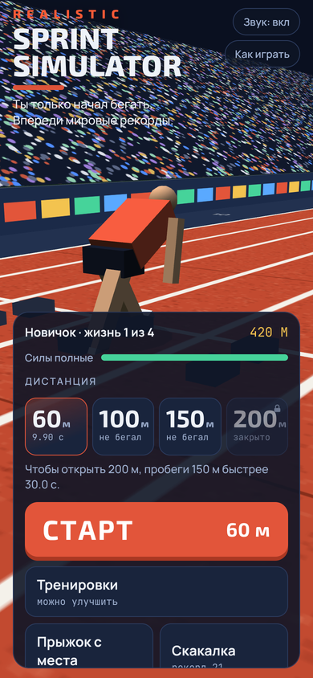
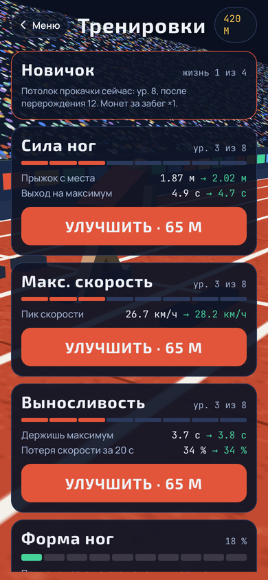
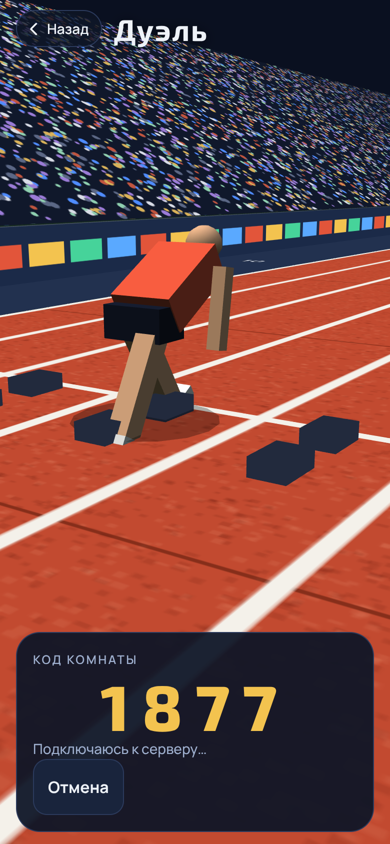

<div align="center">


**Realistic Sprint Simulator.** Тыкаешь в такт, бежишь быстрее. Сбился с ритма, и ноги уже не те.

Мобильная игра про бег на 60, 100, 150 и 200 метров. Одна кнопка, настоящая усталость, обмороки и дуэли с друзьями по коду.


[Скачать](#-скачать) · [Как играть](#-как-играть) · [Дуэли](#-дуэли) · [Как это устроено](#-как-это-устроено)

  

</div>

---

## 💥 Идея

Я хотел игру, где результат зависит не от того, сколько раз ты тапнул, а от того, **как** ты тапнул. Внизу экрана ползёт метка, на кнопке пульсирует зелёное кольцо. Попал в такт, скорость растёт. Опередил или опоздал, и бегун буксует.

А потом оказалось, что бегать на пределе нельзя. Если еле дотащился до конца 200 метров, силы не вернутся минимум минуту реального времени. Выйдешь на следующий забег с пустым баком, и бегун упадёт в обморок на полпути. Прямо на дорожке. С одышкой, красными глазами и сердцем, которое слышно в наушниках.

## 📲 Скачать

1. Открой на телефоне страницу [Releases](../../releases/latest) и скачай `RealisticSprintSimulator.apk`
2. Разреши установку из этого источника, когда Android спросит
3. Запускай и беги

Каждый пуш в `main` собирает свежий APK в GitHub Actions и обновляет релиз `latest`. Руками ничего собирать не нужно.

## 🎮 Как играть

- Жди выстрел. Выскочишь раньше, потеряешь 0,2 секунды
- Жми большую кнопку в такт зелёному кольцу. Метка внизу должна стоять в зелёной зоне
- За забеги и прыжки капают монеты. На них качаются ноги, максимальная скорость и выносливость
- Когда всё прокачано до потолка, можно перерождаться: потолок растёт, монет за забег больше
- Рекорды мира реально побить только после трёх перерождений

| Режим | Что делает |
|---|---|
| Забег | 60, 100, 150 и 200 м. Дальние дистанции открываются быстрыми забегами |
| Прыжок с места | Прокачивает ноги и приносит монеты |
| Скакалка | Тапаешь в ритм, держишь серию |
| Дуэль | Бег против живого друга |

## 😮‍💨 Усталость

Выносливость в игре настоящая:

- на каждую дистанцию нужен запас сил, и чем ниже выносливость, тем он быстрее кончается
- восстановление идёт в реальном времени, примерно от 50 до 75 секунд
- прыжки и скакалка тоже тратят силы
- если бежишь слишком медленно, можно упасть в обморок
- чем ты устал сильнее, тем сильнее экран: тёмные края, красная вуаль, тряска камеры, тяжёлое дыхание и стук сердца

Дыхание на записи, не синтезатор. Первый вариант звучал как хлыст, пришлось записывать живое.

## 🤝 Дуэли

Бежишь с другом, у каждого свой телефон. Один создаёт комнату и получает четыре цифры, второй вводит их. Оба видят соперника на дорожке в реальном времени.

Сервера у игры нет. Связь идёт через публичные MQTT-брокеры по WebSocket, поэтому ничего поднимать не нужно, нужен только интернет.

## 🛠 Как это устроено

| Что | Чем |
|---|---|
| 3D стадион и бегун | Three.js r128 |
| Игра | один `game.js`, без фреймворков |
| Дуэли | MQTT.js |
| Обёртка под Android | Capacitor 6 |
| Сборка APK | GitHub Actions, JDK 17, Gradle |
| Шрифты | Exo 2, Manrope, JetBrains Mono, всё локально |

```
realistic-sprint-simulator/
├── android-icons/    иконки приложения
├── www/              игра: index.html, style.css, game.js, breath.js
├── scripts/          prepare.js копирует three, mqtt и шрифты в www
├── index.html, site/ сайт для скачивания (Pages)
├── docs/             скриншоты и бренд (логотип, иконка)
└── .github/workflows сборка APK и публикация релиза
```

Запустить в браузере:

```bash
npm install
npm run prepare-www
npx serve www
```

Собрать APK руками:

```bash
npx cap add android
npx cap sync android
cd android && ./gradlew assembleDebug
```

## 🧪 Что ломалось по дороге

- APK показывал чёрный экран, потому что в разметке потерялись два блока. Нашёл по скриншоту с телефона
- Gradle отказывался работать на JDK 25, помог JetBrains Runtime 17
- Первая версия лагала из-за размытия и смешивания слоёв. Всё убрал, сглаживание оставил, а частоту кадров теперь просим максимальную

---

<div align="center">

Сделано с ❤️ и ☕. Вайбкодинг присутствует.

</div>
