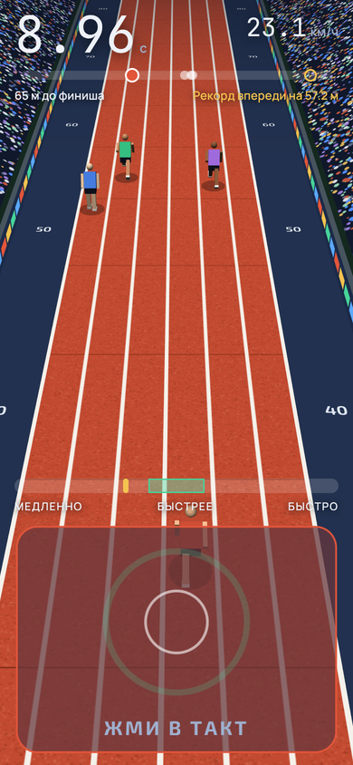

<div align="center">

<a href="https://maks3592.github.io/realistic-sprint-simulator/">

</a>

### Жмёшь в такт, бежишь быстрее. Сбился с ритма, и ноги уже не те.

Мобильная игра про бег на 60, 100, 150 и 200 метров. Одна кнопка, настоящая усталость и обмороки.

[](https://maks3592.github.io/realistic-sprint-simulator/)
[](https://maks3592.github.io/realistic-sprint-simulator/#download)

[](https://maks3592.github.io/realistic-sprint-simulator/)
[](https://github.com/maks3592/realistic-sprint-simulator/releases/latest)
[](https://github.com/maks3592/realistic-sprint-simulator/actions/workflows/build-apk.yml)
[](https://maks3592.github.io/realistic-sprint-simulator/#download)
[](https://threejs.org/)
[](https://capacitorjs.com/)

[Скачать](#-скачать) · [Как играть](#-как-играть) · [Усталость](#-усталость) · [Рекорды](#-рекорды) · [Как устроено](#-как-устроено) · [Сборка](#-собрать-самому)

  

</div>

---

## 💥 Идея

Я хотел игру, где результат зависит не от того, сколько раз ты тапнул, а от того, **как** ты тапнул. Внизу экрана ползёт метка, на кнопке пульсирует зелёное кольцо. Попал в такт, скорость растёт. Опередил или опоздал, и бегун буксует.

А потом оказалось, что бегать на пределе нельзя. Если еле дотащился до конца двухсот метров, силы не вернутся минимум минуту реального времени. Выйдешь на следующий забег с пустым баком, и бегун упадёт в обморок на полпути. С одышкой, тёмными краями экрана и сердцем, которое слышно в наушниках.

## 📲 Скачать

Проще всего с сайта, там же видно, сколько людей уже скачали:

**👉 [maks3592.github.io/realistic-sprint-simulator](https://maks3592.github.io/realistic-sprint-simulator/)**

1. Открой сайт на телефоне и нажми **«Скачать APK»**. Появится панель с прогрессом, файл весит около 4 МБ
2. Открой скачанный `RealisticSprintSimulator.apk` из загрузок
3. Если телефон спросит про установку из неизвестных источников, разреши её для браузера
4. Запускай и беги

<details>
<summary>Другие способы</summary>

- Прямая ссылка на свежую сборку: [Releases](https://github.com/maks3592/realistic-sprint-simulator/releases/latest)
- Каждый пуш в `main` собирает APK в GitHub Actions, обновляет релиз `latest` и выкладывает его на сайт. Руками ничего собирать не нужно

</details>

## 🎮 Как играть

- Жди выстрел. Выскочишь раньше, потеряешь 0,2 секунды
- Жми большую кнопку в такт зелёному кольцу. Метка внизу должна стоять в зелёной зоне
- За забеги и прыжки капают монеты. На них качаются ноги, максимальная скорость и выносливость
- Когда всё прокачано до потолка, можно перерождаться: потолок растёт, монет за забег больше
- Рекорды мира реально побить только после трёх перерождений

| Режим | Что делает |
|---|---|
| 🏁 Забег | 60, 100, 150 и 200 м. Дальние дистанции открываются быстрыми забегами |
| 🦵 Прыжок с места | Прокачивает ноги и приносит монеты |
| 🪢 Скакалка | Тапаешь в ритм, держишь серию |

## 😮‍💨 Усталость

Выносливость тут настоящая, и она ограничивает всё остальное:

| Что происходит | Как это работает |
|---|---|
| Запас сил | На каждую дистанцию нужен свой запас, чем ниже выносливость, тем быстрее он кончается |
| Восстановление | Идёт в реальном времени, примерно от 50 до 75 секунд |
| Прыжки и скакалка | Тоже тратят силы |
| Обморок | Если бежишь слишком медленно или вышел с пустым баком, бегун падает |
| Экран | Чем сильнее усталость, тем темнее края, краснее вуаль и сильнее тряска камеры |
| Звук | Тяжёлое дыхание и стук сердца. Дыхание собрано из настоящей записи: нашёл исходник и сделал звук на его основе |

## 🏆 Рекорды

В игре висят настоящие мировые рекорды:

| Дистанция | Рекорд | Кто |
|---|---|---|
| 60 м | 6,34 с | Кристиан Коулман, 2018 |
| 100 м | 9,58 с | Усейн Болт, 2009 |
| 150 м | 14,35 с | Усейн Болт, 2009 |
| 200 м | 19,19 с | Усейн Болт, 2009 |

На [сайте](https://maks3592.github.io/realistic-sprint-simulator/#records) у каждого рекорда есть своя история, а калькулятор покажет, где ты со своим временем.

## 🛠 Как устроено

| Что | Чем |
|---|---|
| 3D стадион и бегун | Three.js r128 |
| Игра | один `game.js`, без фреймворков |
| Обёртка под Android | Capacitor 6 |
| Сборка APK | GitHub Actions, JDK 17, Gradle |
| Сайт | статика на GitHub Pages, деплой из того же Actions |
| Шрифты | Exo 2, Manrope, JetBrains Mono, всё локально |

```
realistic-sprint-simulator/
├── www/               игра: index.html, style.css, game.js, breath.js
├── android-icons/     иконки приложения
├── scripts/           prepare.js копирует three и шрифты в www
├── index.html, site/  сайт со скачиванием
├── docs/              скриншоты и бренд (логотип, иконка)
└── .github/workflows/ сборка APK, релиз и деплой сайта
```

## 🧰 Собрать самому

Запустить в браузере:

```bash
npm install
npm run prepare-www
npx serve www
```

Собрать APK руками:

```bash
npx cap add android
npx cap sync android
cd android && ./gradlew assembleDebug
```

<details>
<summary>Что ломалось по дороге</summary>

- APK показывал чёрный экран, потому что в разметке потерялись два блока. Нашёл по скриншоту с телефона
- Gradle отказывался работать на JDK 25, помог JetBrains Runtime 17
- Первая версия лагала из-за размытия и смешивания слоёв. Всё убрал, сглаживание оставил, а частоту кадров теперь просим максимальную

</details>

---

<div align="center">

Сделано с ❤️ и ☕. Вайбкодинг присутствует.

</div>
